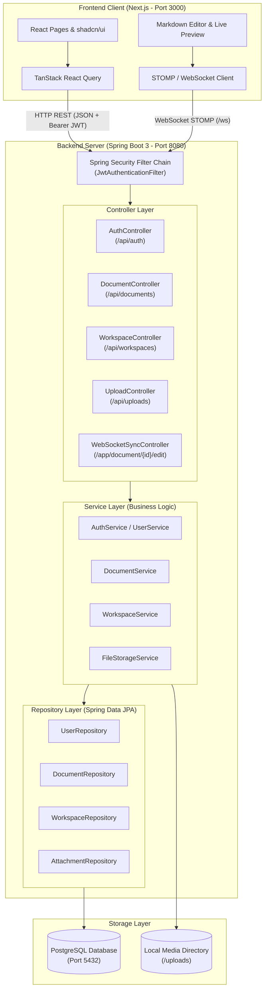
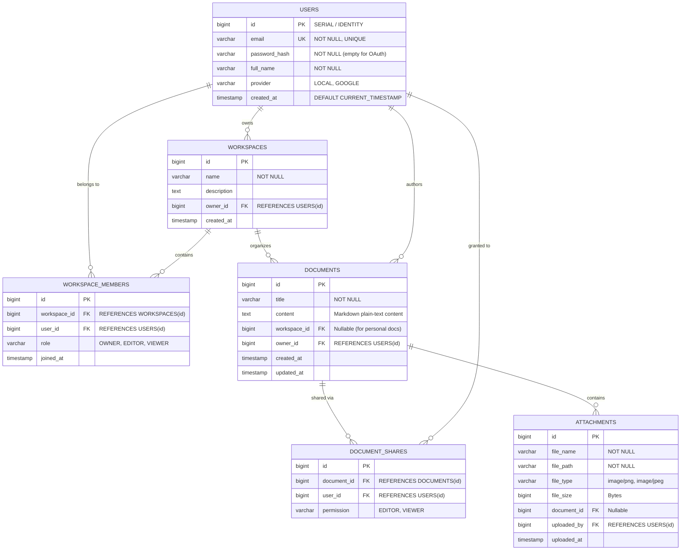

# SyncSpace — Architecture & Project Blueprint
**Project Title:** Collaborative Knowledge Management and Real-Time Markdown Editor  
**Target Level:** College Java Full-Stack Project & Viva Defense Guide  
**Stack:** Java 21 LTS, Spring Boot 3, Spring Security, Spring Data JPA, PostgreSQL, Next.js, TypeScript, Tailwind CSS, WebSockets  

---

## Table of Contents
1. [Project Overview & Core Mission](#1-project-overview--core-mission)
2. [Key Architecture Principles (College-Friendly)](#2-key-architecture-principles-college-friendly)
3. [Technology Stack & Viva Justifications](#3-technology-stack--viva-justifications)
4. [Simplifications & Strategic Decisions](#4-simplifications--strategic-decisions)
5. [System Architecture Diagram](#5-system-architecture-diagram)
6. [Backend Layered Architecture](#6-backend-layered-architecture)
7. [Database Schema & ER Design](#7-database-schema--er-design)
8. [Folder Structure](#8-folder-structure)
9. [REST API & WebSocket Specifications](#9-rest-api--websocket-specifications)
10. [Development Roadmap & Phase Tracker](#10-development-roadmap--phase-tracker)
11. [Testing & Demonstration Plan](#11-testing--demonstration-plan)
12. [Top 15 Java Viva Questions & Answers](#12-top-15-java-viva-questions--answers)

---

## 1. Project Overview & Core Mission

**SyncSpace** is a simplified, lightweight, web-based collaborative workspace tailored for students and team documentation. It combines the structured organization of **Notion** with the real-time collaborative editing capabilities of **Google Docs**, focused on Markdown formatting.

### Core Capabilities:
- **User Authentication:** Secure registration and login using BCrypt password hashing and stateless JSON Web Tokens (JWT).
- **Document Management:** Create, read, update, and delete (CRUD) documents with rich Markdown content stored as plain text.
- **Markdown Editor with Live Preview:** Split-screen interface where users type Markdown on the left and see formatted HTML rendered live on the right.
- **Workspaces & Access Control:** Group documents into team or personal workspaces, with role-based permissions (`OWNER`, `EDITOR`, `VIEWER`).
- **Real-Time Collaboration:** Instant broadcast of document modifications across active browser sessions using Spring Boot WebSockets and STOMP.
- **Media Support:** Local image uploads embedded seamlessly into Markdown documents.
- **OAuth2 Authentication:** Optional single-sign-on (SSO) using Google OAuth2.

---

## 2. Key Architecture Principles (College-Friendly)

1. **Understandability Over Complexity:** Every class, annotation, and library must have an obvious purpose that can be defended in 1–2 minutes during a college viva.
2. **Layered Monolith:** A clean separation of concerns on the backend (`Controller` → `Service` → `Repository` → `Entity`) avoiding unnecessary enterprise patterns or microservices.
3. **Decoupled Client & Server:** A Next.js frontend communicating with a Spring Boot backend strictly via stateless RESTful JSON APIs and WebSocket channels.
4. **Resilience & Zero Cloud Lock-In:** Uses local PostgreSQL and local filesystem storage for media so the project can be demonstrated completely offline or over local Wi-Fi without relying on paid third-party cloud services.

---

## 3. Technology Stack & Viva Justifications

| Layer | Technology | Version | Purpose | Viva Justification (Why chosen?) |
|---|---|---|---|---|
| **Backend Language** | Java | 21 LTS | Core backend programming | Modern LTS release; standard for college Java curricula, features record types and robust standard libraries. |
| **Backend Framework** | Spring Boot | 3.2+ | Rapid backend development | Eliminates XML configuration; provides auto-configuration, embedded Tomcat server, and production-grade dependency management. |
| **Persistence (ORM)** | Spring Data JPA / Hibernate | 3.2+ | Object-Relational Mapping (ORM) | Native Java ORM; replaces manual SQL/JDBC queries with object mapping and built-in CRUD repository methods. |
| **Security** | Spring Security | 6+ | Authentication & Authorization | Industry-standard security filter chain, BCrypt password hashing, and endpoint route protection. |
| **Auth Strategy** | JWT (JSON Web Tokens) | `jjwt` 0.12+ | Stateless user sessions | Eliminates cross-origin cookie issues between port 3000 (frontend) and port 8080 (backend); easy to test in Postman. |
| **Real-Time** | Spring WebSocket (STOMP) | Spring Starter | Live document synchronization | Lightweight publish-subscribe messaging over persistent TCP connections; avoids wasteful HTTP polling. |
| **Database** | PostgreSQL | 15 / 16 | Relational database | ACID-compliant, open-source SQL database with native relational integrity and foreign key support. |
| **Frontend Framework** | Next.js | 14+ (App Router) | Client application | Modern React framework with file-based routing, TypeScript support, and fast client-side rendering. |
| **Frontend Language** | TypeScript | 5+ | Type-safe frontend coding | Prevents runtime bugs by enforcing compile-time type safety for API requests and document models. |
| **Styling & UI** | Tailwind CSS + shadcn/ui | Latest | Modern, responsive UI | Utility-first styling with accessible, clean pre-built components; avoids bulky external UI frameworks. |
| **Server State** | TanStack React Query | v5 | Client-side API caching & fetching | Manages loading, caching, error states, and background refetching cleanly without Redux boilerplate. |

---

## 4. Simplifications & Strategic Decisions

| Original Proposal / Enterprise Norm | SyncSpace Implementation | Reason & Viva Defense |
|---|---|---|
| **Prisma ORM** | **Spring Data JPA + Hibernate** | Prisma is a Node.js ORM. In a Java project, examiners expect JPA/Hibernate. It highlights Java concepts like `@Entity`, `@Id`, and `JpaRepository`. |
| **CRDT / Operational Transformation** | **Document-Level Broadcast via STOMP** | Algorithms like Yjs/CRDT take weeks to implement and are mathematically difficult to debug. A broadcast model with optimistic updates demonstrates WebSockets cleanly with beginner-friendly code. |
| **Stateful Cookie Sessions** | **Stateless JWT Tokens** | Cross-port cookies (`:3000` to `:8080`) trigger complicated CORS and SameSite browser security rules. JWT passed via the `Authorization: Bearer <token>` header is transparent and easy to test. |
| **AWS S3 / Cloudinary Storage** | **Local Disk Storage (`/uploads`)** | Cloud storage requires active credit cards, external credentials, and fast internet. Local disk storage guarantees the live viva demo never fails due to network or billing issues. |

---

## 5. System Architecture Diagram



---

## 6. Backend Layered Architecture

Every backend feature strictly follows the **Controller → Service → Repository → Entity** pattern:

```
HTTP Request 
   │
   ▼
1. Controller Layer: Receives HTTP request, validates DTO inputs, delegates to Service, returns ResponseEntity.
   │
   ▼
2. Service Layer: Contains all business logic (e.g. checking permissions, password hashing, calculations).
   │
   ▼
3. Repository Layer: Interface extending JpaRepository<Entity, Long>; handles SQL queries automatically.
   │
   ▼
4. Entity Layer: Plain Java objects (POJOs) annotated with @Entity representing tables in PostgreSQL.
   │
   ▼
PostgreSQL Database
```

### Purpose of Each Component:
- **Entity:** Represents a table row in PostgreSQL (e.g., `User.java`, `Document.java`).
- **DTO (Data Transfer Object):** Decouples internal database entities from external API payloads, preventing sensitive data exposure (e.g., never returning `password_hash` in an API response).
- **Repository:** An interface where Spring Data JPA automatically generates SQL implementations at runtime.
- **Service:** Keeps controllers thin and readable; handles transactions (`@Transactional`).
- **Controller:** Maps HTTP methods (`@GetMapping`, `@PostMapping`, `@PutMapping`, `@DeleteMapping`) to Java methods.

---

## 7. Database Schema & ER Design



---

## 8. Folder Structure

### Backend (`/backend`)
```
backend/
├── pom.xml                                      # Maven dependencies & plugins
├── uploads/                                     # Local media directory for image uploads
└── src/
    └── main/
        ├── java/com/syncspace/
        │   ├── SyncSpaceApplication.java        # Main class with @SpringBootApplication
        │   ├── config/                          # Configuration classes
        │   │   ├── SecurityConfig.java          # Spring Security filter chain & CORS
        │   │   ├── CorsConfig.java              # Allowed origins (http://localhost:3000)
        │   │   └── WebSocketConfig.java         # STOMP /ws endpoint configuration
        │   ├── controller/                      # REST API Controllers
        │   │   ├── AuthController.java          # /api/auth/register, /api/auth/login
        │   │   ├── DocumentController.java      # /api/documents CRUD
        │   │   ├── WorkspaceController.java     # /api/workspaces
        │   │   ├── UploadController.java        # /api/uploads
        │   │   └── WebSocketSyncController.java # STOMP live document sync handler
        │   ├── dto/                             # Data Transfer Objects
        │   │   ├── AuthRequest.java
        │   │   ├── AuthResponse.java
        │   │   ├── DocumentDto.java
        │   │   └── DocumentSyncMessage.java
        │   ├── entity/                          # JPA Entities
        │   │   ├── User.java
        │   │   ├── Workspace.java
        │   │   ├── WorkspaceMember.java
        │   │   ├── Document.java
        │   │   ├── DocumentShare.java
        │   │   └── Attachment.java
        │   ├── exception/                       # Centralized Exception Handling
        │   │   ├── GlobalExceptionHandler.java  # @ControllerAdvice
        │   │   └── ResourceNotFoundException.java
        │   ├── repository/                      # Spring Data JPA Repositories
        │   │   ├── UserRepository.java
        │   │   ├── WorkspaceRepository.java
        │   │   ├── DocumentRepository.java
        │   │   └── AttachmentRepository.java
        │   ├── security/                        # JWT & Security Helpers
        │   │   ├── JwtUtils.java                # Token generation & validation
        │   │   ├── JwtAuthenticationFilter.java # OncePerRequestFilter parsing Bearer token
        │   │   └── UserDetailsServiceImpl.java  # Loads UserDetails from DB
        │   └── service/                         # Business Logic Layer
        │       ├── UserService.java
        │       ├── DocumentService.java
        │       ├── WorkspaceService.java
        │       └── FileStorageService.java
        └── resources/
            └── application.yml                  # PostgreSQL credentials, server port, JWT secret
```

### Frontend (`/frontend`)
```
frontend/
├── package.json
├── tsconfig.json
├── tailwind.config.ts
└── src/
    ├── app/                                     # Next.js App Router
    │   ├── layout.tsx                           # Global layout with QueryProvider & Toaster
    │   ├── page.tsx                             # Landing page
    │   ├── login/page.tsx                       # Login page
    │   ├── register/page.tsx                    # Register page
    │   └── dashboard/
    │       ├── page.tsx                         # Documents overview & workspaces list
    │       └── document/[id]/page.tsx           # Document editor & preview page
    ├── components/
    │   ├── ui/                                  # Reusable UI components (buttons, dialogs, inputs)
    │   ├── Navbar.tsx                           # Navigation bar with user status & logout
    │   ├── MarkdownEditor.tsx                   # Split-screen text editor + live preview
    │   └── ShareModal.tsx                       # Dialog to share document with other users
    ├── hooks/
    │   ├── useAuth.ts                           # Authentication state & login/logout helpers
    │   └── useDocumentSync.ts                   # WebSocket subscription for real-time sync
    ├── lib/
    │   ├── api.ts                               # Axios instance with JWT Authorization header
    │   └── utils.ts                             # Styling helper functions
    └── types/
        ├── auth.ts                              # User, AuthResponse types
        └── document.ts                          # Document, Workspace types
```

---

## 9. REST API & WebSocket Specifications

### Authentication Endpoints (`/api/auth`)
- `POST /api/auth/register`: Create user account (returns JWT + user details).
- `POST /api/auth/login`: Authenticate email/password (returns JWT + user details).
- `GET /api/auth/me`: Get current logged-in user profile from JWT token.

### Document Endpoints (`/api/documents`)
- `GET /api/documents`: List all documents owned by or shared with current user.
- `POST /api/documents`: Create a new document.
- `GET /api/documents/{id}`: Fetch document by ID (verifies read access).
- `PUT /api/documents/{id}`: Update title or Markdown content (verifies write access).
- `DELETE /api/documents/{id}`: Delete document (owner only).

### Sharing & Workspaces (`/api/workspaces`, `/api/documents/{id}/share`)
- `POST /api/workspaces`: Create a new workspace.
- `GET /api/workspaces`: List user's workspaces.
- `POST /api/documents/{id}/share`: Share document with a user email (`EDITOR` / `VIEWER`).

### Media Endpoints (`/api/uploads`)
- `POST /api/uploads`: Multipart image upload; returns public static URL `/uploads/{filename}`.

### WebSocket STOMP Protocol
- **Endpoint:** `ws://localhost:8080/ws`
- **Publish Destination:** `/app/document/{id}/edit`
- **Subscribe Topic:** `/topic/document/{id}`
- **Message Payload:**
  ```json
  {
    "documentId": 1,
    "userId": 4,
    "senderName": "Sagar",
    "content": "# Updated Markdown Title\nLive edit text...",
    "timestamp": "2026-11-12T23:58:00Z"
  }
  ```

---

## 10. Development Roadmap & Phase Tracker

| Phase | Description | Difficulty | Deliverable |
|:---:|---|:---:|---|
| **Phase 1** | Planning, Architecture & Blueprint | Easy | `ARCHITECTURE.md` finalized |
| **Phase 2** | Spring Boot Setup, Maven & PostgreSQL Connectivity | Easy | Running Spring Boot app connected to PostgreSQL |
| **Phase 3** | User Authentication (BCrypt + JWT + Spring Security) | Medium | Working `/register` and `/login` APIs with Postman tests |
| **Phase 4** | Document CRUD REST APIs with Authorization | Easy–Med | Working document management APIs |
| **Phase 5** | Next.js Setup, Tailwind CSS, shadcn/ui & Auth Pages | Medium | Working frontend login, register, and dashboard |
| **Phase 6** | Markdown Editor with Live Preview & Auto-Save | Medium | **MVP Complete!** Full document creation & preview |
| **Phase 7** | Workspaces & Document Sharing (Owner/Editor/Viewer) | Medium | Workspace grouping & multi-user permission controls |
| **Phase 8** | Real-Time Collaboration (Spring WebSockets + STOMP) | Med–Hard | Live synchronization across two browser windows |
| **Phase 9** | Image Uploads & Markdown Image Embedding | Medium | Image upload API & local storage preview |
| **Phase 10** | OAuth2 Social Login Integration | Medium | Optional Google OAuth2 sign-in |
| **Phase 11** | End-to-End System Integration & Bug Fixing | Medium | Polished application ready for demonstration |
| **Phase 12** | Project Report & Java Viva Defense Preparation | Easy–Med | Viva cheat sheet, diagrams, presentation slides |

---

## 11. Testing & Demonstration Plan

1. **API Testing via Postman:**
   - Test each endpoint with valid and invalid payloads.
   - Verify error responses: `400 Bad Request` on missing fields, `401 Unauthorized` on missing or expired JWT, `403 Forbidden` on unauthorized edits.
2. **Database Verification via PostgreSQL / pgAdmin:**
   - Verify that tables are created automatically by Hibernate (`ddl-auto: update`).
   - Check password hashes to confirm BCrypt hashing (passwords must never appear as plain text in the `users` table).
3. **Frontend User Experience:**
   - Test registration, automatic login redirect, and persistence of JWT in browser storage.
   - Test split-pane Markdown editor: typing Markdown on the left must instantly reflect formatted text, tables, and code snippets on the right.
4. **Dual-Browser Real-Time Collaboration Demo:**
   - Open Chrome Window A (logged in as User 1) and Chrome Window B (Incognito, logged in as User 2).
   - Both users open the same shared document.
   - When User 1 types, User 2's editor updates in real-time without reloading the page.

---

## 12. Top 15 Java Viva Questions & Answers

1. **Q: What is Spring Boot and how does it differ from standard Spring?**  
   *A:* Spring Boot is an opinionated extension of the Spring framework. It eliminates manual XML configuration through **auto-configuration**, provides starter dependencies (`spring-boot-starter-web`), and embeds an HTTP server (Tomcat), enabling standalone runnable JARs.

2. **Q: What is Dependency Injection (DI) and Inversion of Control (IoC)?**  
   *A:* Inversion of Control is a design principle where object creation and lifecycle management are delegated to the Spring container. Dependency Injection is the mechanism used by Spring to inject required dependencies (e.g. injecting a `UserRepository` into a `UserService` using constructor injection).

3. **Q: What is the difference between JDBC and JPA/Hibernate?**  
   *A:* JDBC requires writing raw SQL queries, managing database connections, and manually mapping `ResultSet` columns to Java objects. JPA (Java Persistence API) is a specification, and Hibernate is its ORM implementation that automatically maps Java classes (`@Entity`) to relational database tables, handling CRUD operations automatically.

4. **Q: What does `@RestController` mean?**  
   *A:* It is a convenience annotation combining `@Controller` and `@ResponseBody`. It tells Spring that the return value of handler methods should be serialized directly into HTTP response bodies (usually JSON) rather than rendering an HTML view template.

5. **Q: Why did you use DTOs instead of passing Entities directly to controllers?**  
   *A:* DTOs (Data Transfer Objects) prevent over-fetching and mass-assignment vulnerabilities. They hide internal database structures (like password hashes) and ensure API contracts remain decoupled from database schema changes.

6. **Q: How does BCrypt password hashing work?**  
   *A:* BCrypt is a one-way cryptographic hash function that incorporates a random salt to protect against rainbow table attacks. It has an adjustable work factor (cost), making brute-force attacks computationally expensive. Passwords cannot be decrypted—only matched using `BCrypt.checkpw()`.

7. **Q: What is a JWT and how does it make authentication stateless?**  
   *A:* A JSON Web Token consists of three parts: Header, Payload (claims), and Signature. The server cryptographically signs the token with a secret key. Since all user identity data is stored in the token itself, the server does not need to store session state in memory or a database, enabling horizontal scalability.

8. **Q: How does Spring Data JPA create queries without SQL?**  
   *A:* Spring Data JPA analyzes method naming conventions (e.g. `findByEmail(String email)`) and uses Dynamic Proxy mechanisms at runtime to generate the corresponding JPQL/SQL query automatically.

9. **Q: What is the purpose of `@Transactional`?**  
   *A:* It ensures that a series of database operations execute within a single database transaction. If any runtime exception occurs, all changes are rolled back automatically, maintaining ACID consistency.

10. **Q: What is the difference between `@ManyToOne` and `@OneToMany`?**  
    *A:* In relational terms, they represent a foreign key relationship. For example, many `Document` records can belong to one `User` (`@ManyToOne` in `Document`), and one `User` can own a list of `Document` records (`@OneToMany` in `User`).

11. **Q: What are WebSockets and how do they differ from HTTP?**  
    *A:* HTTP is a unidirectional, request-response protocol where the client initiates all communication. WebSockets provide a full-duplex, bi-directional persistent TCP connection over a single socket, allowing the server to push updates to clients instantaneously.

12. **Q: What is STOMP and why is it used over plain WebSockets?**  
    *A:* STOMP (Simple Text Oriented Messaging Protocol) defines a standard frame format (like `CONNECT`, `SUBSCRIBE`, `SEND`) on top of WebSockets. It enables message-broker publish/subscribe patterns, routing messages to specific topics (e.g., `/topic/document/{id}`).

13. **Q: How does the split-screen Markdown preview work on the frontend?**  
    *A:* The left pane is a controlled `<textarea>` bound to React state. As the user types, the plain-text Markdown is passed to a Markdown rendering library (e.g. `react-markdown`), which parses syntax into an Abstract Syntax Tree (AST) and renders safe HTML on the right pane in real-time.

14. **Q: What is CORS and why is it needed?**  
    *A:* Cross-Origin Resource Sharing (CORS) is a browser security mechanism that blocks scripts on one origin (`http://localhost:3000`) from making requests to a different origin (`http://localhost:8080`). We configure Spring Boot's `CorsRegistry` to explicitly allow our frontend origin.

15. **Q: What is an ExceptionHandler / `@ControllerAdvice` in Spring Boot?**  
    *A:* `@ControllerAdvice` allows centralized global exception handling across all controllers. Instead of writing try-catch blocks everywhere, unhandled exceptions are intercepted and converted into standardized JSON error responses with proper HTTP status codes.

