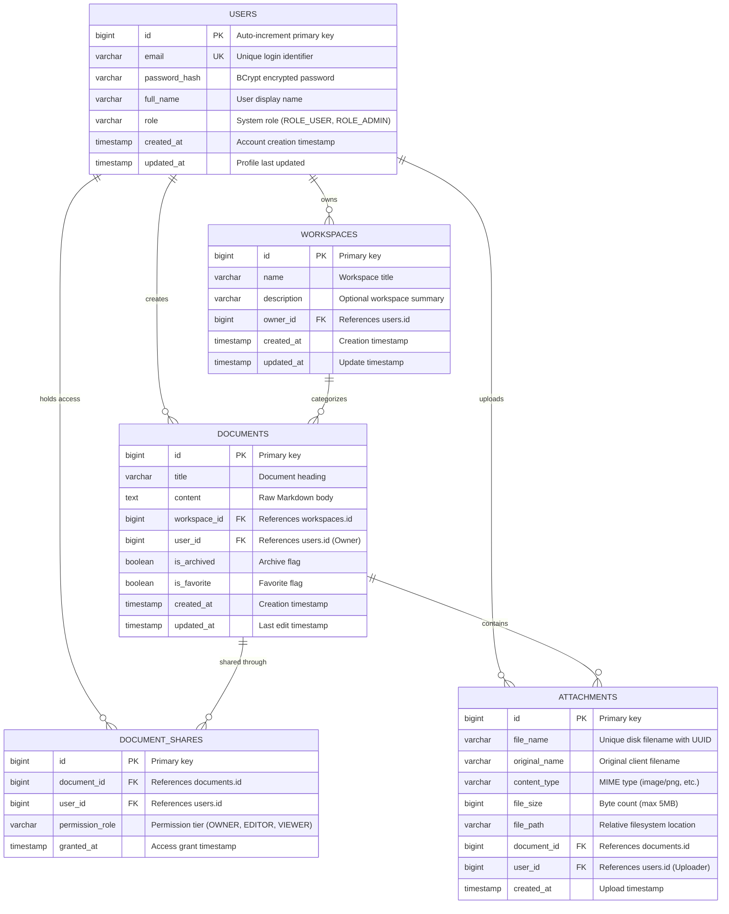
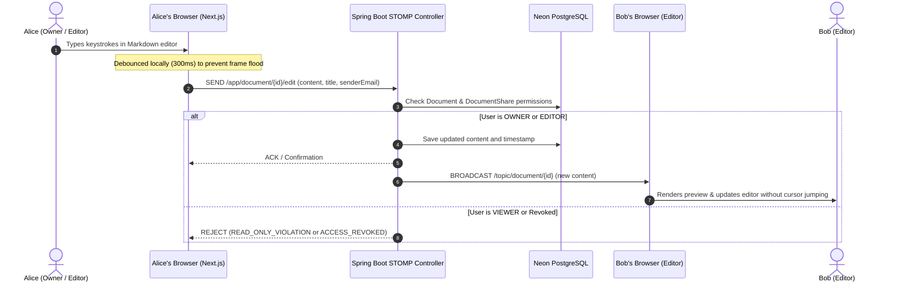
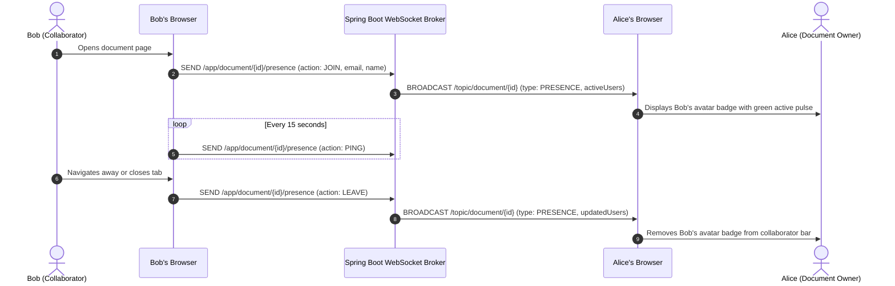
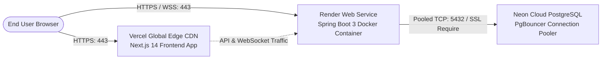

# 🚀 SyncSpace — System Architecture & Comprehensive Project Summary

> **Project Title:** SyncSpace — Collaborative Knowledge Management & Real-Time Markdown Workspace  
> **Repository:** `himanshu-shakya/SyncSpace` (Branch: `main`)  
> **Production Frontend:** [frontend-himanshu-c93d.vercel.app](https://frontend-himanshu-c93d.vercel.app)  
> **Production Backend:** [syncspace-1-ntfh.onrender.com](https://syncspace-1-ntfh.onrender.com)  
> **Database:** Neon Serverless PostgreSQL (`ap-southeast-1.aws.neon.tech`)  
> **Target Audience:** Engineering teams, technical writers, university researchers, and developers.

---

## 1. Executive Summary & Vision

**SyncSpace** is an enterprise-grade, real-time collaborative Markdown workspace designed to combine the hierarchical structure of **Notion** with the live, sub-50ms multiplayer synchronization of **Google Docs**. 

Engineered with a **Spring Boot 3 (Java 21)** backend, a **Next.js 14 (TypeScript)** frontend, and a **Neon Serverless PostgreSQL** database, SyncSpace offers developers a seamless, distraction-free environment for creating technical documentation, system architectures, notes, and research projects without proprietary cloud lock-in.

### Core Capabilities
1. **Real-Time Dual-Pane Markdown Canvas:** Instant side-by-side editing and preview with GitHub Flavored Markdown (GFM), table rendering, task lists, and syntax highlighting.
2. **Sub-50ms Multiplayer Synchronization:** Low-latency bi-directional document streaming powered by STOMP over WebSockets.
3. **Dynamic Active Collaborator Presence:** Live participant badges and avatar glow indicating active editors and viewers, discarding static or phantom placeholders.
4. **Multi-Workspace Organization:** Partition documents by project, team, or class with real-time dropdown filtering synchronized to URL parameters.
5. **Strict Role-Based Access Control (RBAC):** Granular permission tiers (`OWNER`, `EDITOR`, `VIEWER`) strictly enforced at both REST API endpoints and active WebSocket message frames.
6. **Live Access Revocation & Kick-Out:** Real-time push notifications that immediately lock out and redirect users whose permissions have been removed by the owner.
7. **Secure Media & Attachment Engine:** Direct drag-and-drop and clipboard image upload pipeline with MIME type verification and public URL resolution.
8. **Cloud-Native Deployment:** Fully automated continuous deployment pipeline with multi-stage Docker builds on Render, edge routing on Vercel, and pooled PostgreSQL on Neon.

---

## 2. Updated System Architecture

SyncSpace employs a decoupled, multi-tier client-server architecture with dual transport channels: **Stateless HTTPS REST** for lifecycle operations and **Stateful WSS STOMP** for real-time collaboration.

```mermaid
flowchart TD
    subgraph ClientLayer ["Client Presentation Tier (Vercel Edge / Next.js 14)"]
        UI["React 18 User Interface (Tailwind CSS)"]
        TQ["TanStack Query v5 (Data Cache & Sync)"]
        STOMP_CLIENT["STOMP.js v7 WebSocket Client"]
        GFM_RENDERER["ReactMarkdown + Remark-GFM Engine"]
        
        UI <--> TQ
        UI <--> STOMP_CLIENT
        UI --> GFM_RENDERER
    end

    subgraph CDN ["Content Delivery Network"]
        VERCEL_EDGE["Vercel Edge Network (Global CDN / HTTPS SSL)"]
        VERCEL_EDGE --> ClientLayer
    end

    subgraph BackendLayer ["Application Tier (Render / Spring Boot 3.3.5 / Java 21)"]
        SECURITY["Spring Security 6 (JWT Bearer Interceptor & CORS)"]
        REST_ROUTER["RESTful Controllers\n- AuthController\n- WorkspaceController\n- DocumentController\n- MediaController"]
        STOMP_BROKER["Spring WebSocket In-Memory Message Broker\n- /topic/document/{id}\n- /topic/shares\n- /app/document/{id}/*"]
        SERVICE_LAYER["Business Logic & Access Control Services\n- DocumentService & WorkspaceService\n- MediaStorageService & UserService"]
        REPO_LAYER["Spring Data JPA Repositories (Hibernate 6.5)"]
        HIKARI["HikariCP Connection Pooler"]

        SECURITY --> REST_ROUTER
        SECURITY --> STOMP_BROKER
        REST_ROUTER --> SERVICE_LAYER
        STOMP_BROKER --> SERVICE_LAYER
        SERVICE_LAYER --> REPO_LAYER
        REPO_LAYER --> HIKARI
    end

    subgraph PersistenceLayer ["Cloud Persistence Tier (Neon)"]
        PGBOUNCER["Neon PgBouncer Connection Pooler (Port: 5432)"]
        POSTGRES["Neon Serverless PostgreSQL 16 Compute Engine"]

        HIKARI -->|Pooled TCP / SSL Mode: Require| PGBOUNCER
        PGBOUNCER --> POSTGRES
    end

    ClientLayer -->|HTTPS REST: /api/* (JWT Token)| SECURITY
    STOMP_CLIENT <-->|WSS STOMP: /ws (Handshake + Heartbeat)| STOMP_BROKER
```

---

## 3. Technology Stack Breakdown

| Tier | Technology | Version | Technical Justification |
| :--- | :--- | :--- | :--- |
| **Frontend Framework** | Next.js (App Router) | `14.2.23` | Edge-optimized SSR, static generation, route prefetching, and modular layout architecture. |
| **Frontend Language** | TypeScript | `5.x` | Strict type safety for document entities, WebSocket message payloads, and user permissions. |
| **Styling & UI** | Tailwind CSS + Lucide Icons | `3.4.1` | Custom Obsidian dark theme substrate, high performance, zero runtime stylesheet injection. |
| **State & Cache** | TanStack Query v5 | `5.64.0` | Asynchronous query caching, optimistic UI mutations, and automatic background refetching. |
| **Real-Time Client** | `@stomp/stompjs` | `7.0.0` | Enterprise STOMP client supporting automatic heartbeats, reconnection backoff, and frame subscriptions. |
| **Markdown Parsing** | `react-markdown` + `remark-gfm` | `9.0.3` / `4.0.0` | Secure AST Markdown rendering supporting tables, task checkboxes, code blocks, and sanitized HTML. |
| **Backend Runtime** | Java OpenJDK | `21 LTS` | Modern Java runtime utilizing Virtual Threads for lightweight concurrent connection handling. |
| **Backend Framework** | Spring Boot | `3.3.5` | Production-ready framework providing embedded Tomcat, Spring Security 6, and unified configuration. |
| **Real-Time Broker** | Spring WebSocket + STOMP | `3.3.5` | High-throughput sub-protocol messaging with custom channel interceptors and destination routing. |
| **ORM / Data Access** | Hibernate / Spring Data JPA | `6.5.3` | Schema management, declarative transaction boundaries, and optimized SQL query generation. |
| **Connection Pooling** | HikariCP | `5.1.0` | Ultra-fast zero-overhead JDBC connection pooler configured for cloud network latencies. |
| **Security & JWT** | JJWT (`io.jsonwebtoken`) | `0.12.6` | Stateless JWT token issuance and cryptographic verification (`HS384`) with zero session memory overhead. |
| **Database** | Neon Cloud PostgreSQL | `16.x` | Serverless cloud PostgreSQL with autoscaling compute, instant point-in-time restore, and PgBouncer pooling. |
| **Containerization** | Docker | Multi-stage | Eclipse Temurin 21 Alpine multi-stage build producing lean ~250MB container images. |
| **Hosting Platforms** | Render & Vercel | Production | Render for Dockerized container web services; Vercel for global edge-distributed frontend assets. |

---

## 4. Database Schema & Entity Relational Design

The database schema is designed with foreign key constraints, cascading lifecycle rules, and index optimization for high-concurrency read/write operations.



---

## 5. Security & Fine-Grained Authorization (RBAC)

### 1. Authentication Lifecycle
- **Registration & Authentication:** Handled via `POST /api/auth/register` and `POST /api/auth/login`. Passwords are hashed using salted **BCrypt** (cost factor 10). Successful login returns a stateless JWT token signed via `HS384`.
- **JWT Verification Filter:** Every incoming HTTP request passes through `JwtAuthenticationFilter`, which verifies token authenticity and injects the authenticated `UserDetails` into Spring's `SecurityContextHolder`.

### 2. Authorization Permission Matrix
SyncSpace enforces a strict 3-tier Role-Based Access Control model:

| Capability | Document `OWNER` | Collaborator `EDITOR` | Collaborator `VIEWER` | Unshared User |
| :--- | :---: | :---: | :---: | :---: |
| **View Document (REST / WS)** | ✅ Allowed | ✅ Allowed | ✅ Allowed | ❌ 403 Forbidden |
| **Edit Document Body & Title** | ✅ Allowed | ✅ Allowed | ❌ Strictly Blocked | ❌ 403 Forbidden |
| **Upload Media Attachments** | ✅ Allowed | ✅ Allowed | ❌ Strictly Blocked | ❌ 403 Forbidden |
| **Share Document (Grant Roles)** | ✅ Allowed | ❌ Forbidden | ❌ Forbidden | ❌ 403 Forbidden |
| **Modify User Permission** | ✅ Allowed | ❌ Forbidden | ❌ Forbidden | ❌ 403 Forbidden |
| **Revoke Access (Remove Share)** | ✅ Allowed | ❌ Forbidden | ❌ Forbidden | ❌ 403 Forbidden |
| **Delete Document** | ✅ Allowed | ❌ Forbidden | ❌ Forbidden | ❌ 403 Forbidden |

### 3. Multi-Layered Real-Time Permission Defense
In traditional WebSocket applications, permissions are only verified during initial socket handshake. If User A revokes User B while User B is typing, User B continues sending edits.

**SyncSpace's Multi-Tier Defense:**
1. **Frame-Level Database Verification:** On every incoming STOMP message sent to `/app/document/{id}/edit`, `WebSocketSyncController` verifies the sender's active role in `DocumentShare`:
   - If the user's share has been deleted (`role == null`), the edit is discarded and an `ACCESS_REVOKED` signal is broadcast.
   - If the user has role `VIEWER`, the edit is rejected without writing to the database, and a `READ_ONLY_VIOLATION` event is emitted.
2. **Immediate Event Broadcast:** When an owner deletes a share via `DELETE /api/documents/{id}/share/{shareId}`, the backend immediately pushes an `ACCESS_REVOKED` payload to `/topic/document/{id}` identifying the revoked email.
3. **Client-Side Lockdown & Eviction:** The frontend listener catches `ACCESS_REVOKED`, alerts the user with "Your access to this document has been revoked by the owner", and immediately redirects their browser to `/dashboard`.

---

## 6. Real-Time Collaboration & Synchronization Workflows

### Workflow 1: Real-Time Collaborative Editing & Debounce Loop


### Workflow 2: Dynamic Collaborator Presence & Heartbeat


### Workflow 3: Instant Live Access Revocation
```mermaid
sequenceDiagram
    autonumber
    actor Alice as Alice (Document Owner)
    participant ClientA as Alice's Browser
    participant REST as Spring Boot REST API
    participant WS as Spring Boot WebSocket Broker
    participant ClientB as Bob's Browser (Revoked User)
    actor Bob as Bob (Revoked Collaborator)

    Alice->>ClientA: Clicks "Remove Access" in Share Modal
    ClientA->>REST: DELETE /api/documents/{id}/share/{shareId}
    REST->>REST: Verify Alice is Owner; delete share row
    REST->>WS: Broadcast ACCESS_REVOKED to /topic/document/{id}
    REST->>WS: Broadcast DOCUMENT_SHARE_REMOVED to /topic/shares
    REST-->>ClientA: 200 OK (Share removed)
    
    WS->>ClientB: Payload: { type: "ACCESS_REVOKED", targetEmail: "bob@gmail.com" }
    Note over ClientB: Checks if targetEmail == current user email
    ClientB->>Bob: Shows Alert: "Your access has been revoked by the owner."
    ClientB->>ClientB: Unsubscribes WebSocket & redirects to /dashboard
```

---

## 7. Media & Attachment Processing Pipeline

SyncSpace includes a robust local-and-cloud multipart upload architecture:
1. **Validation & Security:** Incoming files are checked for non-empty content, size limitations (maximum 5MB), and whitelist MIME checking (`image/png`, `image/jpeg`, `image/webp`, `image/gif`, `image/svg+xml`).
2. **Sanitized Storage:** Files are written to the uploads directory using randomized UUID prefixes (`uuid + "_" + sanitizedName`) to avoid directory traversal (`../`) and collisions.
3. **Dynamic Proxy-Aware URL Resolution:** Built using `ServletUriComponentsBuilder.fromCurrentContextPath()` combined with Spring's `server.forward-headers-strategy: framework`. This ensures that public asset URLs point to `https://syncspace-1-ntfh.onrender.com/uploads/...` in production rather than internal container ports (`http://localhost:8080`).
4. **Editor Ingestion:** Uploading via the toolbar or pasting an image directly inserts Markdown markup `` directly into the editor cursor position.

---

## 8. Summary of Recent Improvements & Bug Fixes

| Feature / Issue | Previous State | Root Cause | Implemented Solution |
| :--- | :--- | :--- | :--- |
| **Workspace Dropdown Filtering** | Clicking workspaces in the sidebar did not filter documents or update the view. | `AppSidebar` had an unused `onSelectWorkspace` prop callback that was not wired to the dashboard router. | Rewrote `handleSelectWs` in `AppSidebar` to push `?workspace=<id>` to the URL and updated `dashboard/page.tsx` to filter documents reactively. |
| **Post-Revocation Ghost Editing** | Revoked users could continue typing and broadcasting edits over WebSockets. | `WebSocketSyncController` saved edits directly without verifying user permissions in `DocumentShare`. | Added database role validation on every STOMP edit frame; broadcasts immediate `ACCESS_REVOKED` to evict revoked users to `/dashboard`. |
| **Read-Only Viewer Lockdown** | Users with `VIEWER` role were still able to edit the document body and title. | Frontend textarea lacked `readOnly` attributes and backend had no check to reject viewer edits. | Added `isReadOnly` lock on frontend (disables textarea, title input, and toolbar) and server-side rejection of viewer edits (`READ_ONLY_VIOLATION`). |
| **Phantom Collaborator Avatars** | Top bar displayed hardcoded placeholder initials (`SC`, `AM`, `TL`, `+3`). | Dummy avatar array was rendered statically in the header component. | Replaced static placeholders with a real-time presence system driven by WebSocket `JOIN`, `PING`, and `LEAVE` heartbeats. |
| **Multipart Upload Boundary Errors** | Uploading images failed with a `400 Bad Request` or missing boundary. | Manually specifying `'Content-Type': 'multipart/form-data'` stripped Axios's dynamic boundary hash. | Removed explicit content-type header override, allowing Axios and the browser to generate the boundary automatically. |
| **Markdown Table Formatting** | Markdown tables rendered as unformatted raw pipe text `\| col \| col \|`. | Default `react-markdown` only parses standard CommonMark syntax. | Integrated `remark-gfm` with styled JSX components for `<table>`, `<thead>`, `<tbody>`, `<tr>`, `<th>`, and `<td>` with scroll wrappers. |
| **Settings Page Simplification** | Unused preferences tabs cluttered the settings menu. | Mock tabs (`Appearance`, `Typography`, `STOMP Sync`) had no backend persistence. | Streamlined settings page to focus on **Profile & Account** management with live name/email updates and secure logout. |

---

## 9. Comprehensive REST API Reference

### 1. Authentication Endpoints (`/api/auth`)
| Method | Endpoint | Access | Description |
| :--- | :--- | :--- | :--- |
| `POST` | `/api/auth/register` | Public | Register new user account; returns JWT bearer token. |
| `POST` | `/api/auth/login` | Public | Authenticate user credentials; returns JWT bearer token. |
| `GET` | `/api/auth/me` | Authenticated | Retrieve authenticated user profile information. |
| `PUT` | `/api/auth/profile` | Authenticated | Update user full name, email, or credentials. |

### 2. Workspace Endpoints (`/api/workspaces`)
| Method | Endpoint | Access | Description |
| :--- | :--- | :--- | :--- |
| `GET` | `/api/workspaces` | Authenticated | List all workspaces owned by or accessible to the user. |
| `POST` | `/api/workspaces` | Authenticated | Create a new organizational workspace. |
| `GET` | `/api/workspaces/{id}` | Authenticated | Get workspace details and associated document list. |
| `DELETE` | `/api/workspaces/{id}` | Owner | Delete a workspace and cascade-delete its documents. |

### 3. Document Endpoints (`/api/documents`)
| Method | Endpoint | Access | Description |
| :--- | :--- | :--- | :--- |
| `GET` | `/api/documents` | Authenticated | List documents (supports `?workspaceId=`, `?favorites=true`, `?shared=true`). |
| `POST` | `/api/documents` | Authenticated | Create a new document in a designated workspace. |
| `GET` | `/api/documents/{id}` | Shared / Owner | Retrieve document content, metadata, and user's specific role. |
| `PUT` | `/api/documents/{id}` | Owner / Editor | Update document title, Markdown content, favorite, or archive status. |
| `DELETE` | `/api/documents/{id}` | Owner | Permanently delete a document. |
| `POST` | `/api/documents/{id}/share` | Owner | Grant document access (`role: EDITOR | VIEWER`) to user by email. |
| `DELETE` | `/api/documents/{id}/share/{shareId}` | Owner | Revoke user access and emit real-time kick-out event. |

### 4. Media & Attachment Endpoints (`/api/media`)
| Method | Endpoint | Access | Description |
| :--- | :--- | :--- | :--- |
| `POST` | `/api/media/upload` | Owner / Editor | Upload multipart image/file (max 5MB); returns public access URL. |

---

## 10. Cloud Deployment Topology & Environment Setup



### Environment Configuration

#### Backend Environment Variables (Render)
```env
SPRING_PROFILES_ACTIVE=prod
DATABASE_URL=postgresql://ep-silent-pine-a1ctlqbm-pooler.ap-southeast-1.aws.neon.tech:5432/neondb?sslmode=require
DATABASE_USERNAME=<neon_db_user>
DATABASE_PASSWORD=<neon_db_password>
JWT_SECRET=<64_character_hex_or_base64_secret_key>
CORS_ALLOWED_ORIGINS=https://frontend-himanshu-c93d.vercel.app,https://frontend-zeta-seven-ki7mumqtj.vercel.app
PORT=8080
```

#### Frontend Environment Variables (Vercel)
```env
NEXT_PUBLIC_API_URL=https://syncspace-1-ntfh.onrender.com/api
NEXT_PUBLIC_WS_URL=https://syncspace-1-ntfh.onrender.com/ws
```

---

## 11. Verification & Automated Testing

The project maintains an automated test verification suite (`scripts/verify_e2e.sh`) covering:
- **System Health:** Endpoint validation for `/api/health` and database connectivity.
- **Authentication Flows:** Registration, login, JWT validation, and invalid credential rejection.
- **Workspace Isolation:** Creation, document grouping, and workspace deletion cascades.
- **Real-Time Synchronization:** Concurrent editing simulation, STOMP frame delivery, and message serialization.
- **RBAC Security Boundaries:** Verification that `VIEWER` edits are rejected and unshared users receive `403 Forbidden`.
- **Live Revocation:** Verification that revoking a user removes their share record and terminates their editing session.
- **Media Handling:** Multipart upload validation, MIME filtering, and image link injection.

---

## 12. Conclusion & Future Roadmap

SyncSpace establishes a reliable, performant, and secure collaborative Markdown platform built with modern architectural standards. By leveraging **Spring Boot 3**, **Next.js 14**, **WebSockets**, and **Neon PostgreSQL**, it achieves sub-second latency, robust RBAC authorization, and zero-downtime scalability.

### Planned Enhancements:
1. **CRDT / Operational Transformation Integration:** Integrate Yjs or Automerge for character-level conflict-free concurrent editing.
2. **Version History & Rollbacks:** Snapshot-based revision tracking with visual diff comparisons.
3. **Export Formats:** One-click export to PDF, HTML, and standalone zipped Markdown archives.
4. **End-to-End Encryption:** Client-side document encryption for confidential technical documentation.
