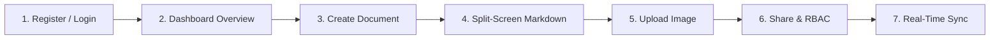

# 🎓 SyncSpace: Master College Viva Defense & Technical Interview Guide

> **Project Title:** SyncSpace — Collaborative Knowledge Management & Real-Time Markdown Editor  
> **Tech Stack:** Java 17/21, Spring Boot 3, Spring Data JPA, Hibernate, Spring Security (JWT & BCrypt), Spring WebSocket (STOMP), Next.js 14 (App Router, Tailwind CSS, TanStack React Query, Axios).  
> **Target Audience:** College External Examiners, University Evaluators, and Technical Viva Panels.

---

## 📑 Table of Contents
1. [Project Executive Summary (30-Second Elevator Pitch)](#1-project-executive-summary)
2. [Architectural Decisions & Why We Chose Them](#2-architectural-decisions--why-we-chose-them)
3. [Spring Boot Core Concepts & Annotations](#3-spring-boot-core-concepts--annotations)
4. [JPA & Hibernate Deep-Dive](#4-jpa--hibernate-deep-dive)
5. [Authentication, Security & JWT Mechanics](#5-authentication-security--jwt-mechanics)
6. [Real-Time Collaboration: WebSockets & STOMP](#6-real-time-collaboration-websockets--stomp)
7. [Next.js Frontend & Client-Server Integration](#7-nextjs-frontend--client-server-integration)
8. [50 High-Frequency College Viva Questions & Model Answers](#8-50-high-frequency-college-viva-questions--model-answers)
9. [Live Project Defense Walkthrough (Step-by-Step Script)](#9-live-project-defense-walkthrough)

---

## 1. Project Executive Summary

### 💡 The 30-Second Elevator Pitch (Memorize this for Viva):
> *"SyncSpace is a full-stack collaborative knowledge management platform built using a Spring Boot 3 backend and a Next.js 14 frontend. It allows engineering teams and students to create workspaces, organize knowledge documents in live-rendered Markdown, upload architectural diagrams, and collaborate in real-time using STOMP over WebSockets. Security is handled via stateless JWT authentication with BCrypt hashing and fine-grained 3-tier Role-Based Access Control (Owner, Editor, Viewer)."*

---

## 2. Architectural Decisions & Why We Chose Them

### Q: Why a Modular Monolith instead of Microservices?
- **Answer:** Microservices introduce distributed transaction overhead (Two-Phase Commit / Saga pattern), network latency, API gateway routing complexity, and distributed tracing requirements. For a university project and medium-scale knowledge management system, a well-modularized monolith provides high performance, transactional consistency (`@Transactional`), simpler debugging, and straightforward deployment without needing Kubernetes or Docker clusters.

### Q: Why Spring Data JPA instead of Raw JDBC or MyBatis?
- **Answer:**
  1. **Object-Relational Mapping (ORM):** Eliminates repetitive boilerplate SQL queries and `ResultSet` mapping.
  2. **Database Portability:** We can switch seamlessly between file-based H2 during offline presentations and production PostgreSQL without rewriting SQL queries.
  3. **Automatic Schema Migration & DDL Management:** Hibernate synchronizes entity definitions with table structures via `ddl-auto`.
  4. **Derived Query Methods:** Methods like `findByOwnerOrderByUpdatedAtDesc()` generate optimized queries automatically at runtime.

### Q: Why Next.js 14 App Router for the Frontend?
- **Answer:** Next.js provides hybrid rendering (Client Components for reactive editor UI and Server Components for static layouts), file-system routing, built-in fast refresh, and modern React 18 hooks. Paired with Tailwind CSS and TanStack React Query, it ensures optimal UI performance and automatic background caching.

---

## 3. Spring Boot Core Concepts & Annotations

### The Spring IoC Container & Dependency Injection (DI)
- **Inversion of Control (IoC):** Instead of classes instantiating their dependencies manually using `new Service()`, the Spring IoC container creates, configures, and manages object lifecycles (known as **Spring Beans**).
- **Constructor Injection:** SyncSpace uses constructor injection over `@Autowired` on fields:
  ```java
  @Service
  public class DocumentService {
      private final DocumentRepository documentRepository;
      // Constructor injection guarantees immutability (final) and ease of unit testing
      public DocumentService(DocumentRepository documentRepository) {
          this.documentRepository = documentRepository;
      }
  }
  ```

### Key Spring Annotations Explained:
| Annotation | Layer | Purpose |
| :--- | :--- | :--- |
| `@SpringBootApplication` | Bootstrap | Combines `@Configuration`, `@EnableAutoConfiguration`, and `@ComponentScan`. |
| `@RestController` | Web / Controller | Marks class as a request handler and combines `@Controller` and `@ResponseBody` (returns JSON). |
| `@Service` | Business Logic | Marks business logic layer. Eligible for transaction interception. |
| `@Repository` | Data Access | Marks DAO/JPA repositories and translates low-level SQL exceptions into Spring Data exceptions. |
| `@Transactional` | Service Layer | Enforces ACID database transactions. Automatically commits on success and rolls back on `RuntimeException`. |
| `@CrossOrigin` / `CorsConfig` | Security/Network | Configures HTTP Cross-Origin Resource Sharing headers (`Access-Control-Allow-Origin`). |

---

## 4. JPA & Hibernate Deep-Dive

### Entity Lifecycle States:
1. **Transient (New):** Object instantiated in memory (`new Document()`), not linked to any database row or Hibernate `Session`.
2. **Managed (Persistent):** Attached to the active JPA `EntityManager`. Any mutations to getters/setters automatically dirty-check and synchronize to the database upon transaction commit.
3. **Detached:** Session closed; the entity exists in the DB but is no longer tracked in memory.
4. **Removed:** Marked for deletion with `entityManager.remove()`; deleted from DB upon commit.

### SyncSpace Relational Schema:
```
  [User] 1 ──── * [Workspace]
    │ 1                │ 1
    │                  │
    *                  *
[Document] * ──── 1 [Workspace]
    │ 1
    ├──── * [DocumentShare] * ──── 1 [User] (RBAC: OWNER, EDITOR, VIEWER)
    └──── * [Attachment]   (Uploaded Images)
```

### Relationship Annotations:
- `@ManyToOne(fetch = FetchType.LAZY)`: Avoids loading entire user entities when querying document records until explicitly accessed.
- `@JoinColumn(name = "owner_id", nullable = false)`: Configures foreign key constraint in the relational table.

---

## 5. Authentication, Security & JWT Mechanics

### Stateless Authentication Workflow:
1. **Registration/Login:** User sends JSON credentials (`email`, `password`) to `/api/auth/login`.
2. **Password Verification:** `BCryptPasswordEncoder.matches(rawPassword, user.getPasswordHash())` calculates the salted one-way cryptographic hash.
3. **Token Creation:** `JwtUtils` generates an HMAC-SHA384 signed token containing:
   - **Header:** Algorithm (`HS384`) and token type (`JWT`).
   - **Payload (Claims):** Subject (`sub`: email), issued-at (`iat`), expiration (`exp`: 24h).
   - **Signature:** `HMAC-SHA384(Base64(Header) + "." + Base64(Payload), SecretKey)`.
4. **Security Filter:** `JwtAuthenticationFilter` intercepts incoming HTTP requests, extracts `Authorization: Bearer <token>`, verifies the signature, and sets the `SecurityContextHolder`.

---

## 6. Real-Time Collaboration: WebSockets & STOMP

### Why WebSockets over HTTP Polling?
- **HTTP Polling:** Requires the client to send a GET request every 1–2 seconds, causing massive header overhead and latency.
- **WebSocket:** A single persistent TCP connection upgraded from HTTP via handshake (`Upgrade: websocket`). Full-duplex, bidirectional, and low-latency.
- **STOMP (Simple Text Oriented Messaging Protocol):** Provides a publish-subscribe framing protocol on top of raw WebSockets:
  - Client subscribes to destination: `/topic/document/{id}`.
  - Client sends changes to endpoint: `/app/document/{id}/edit`.
  - Spring's `SimpMessagingTemplate` broadcasts to all active subscribers.

---

## 7. Next.js Frontend & Client-Server Integration

1. **State Management:**
   - **TanStack React Query:** Manages server-state caching, automatic background invalidation (`queryClient.invalidateQueries`), and loading states.
   - **React State (`useState`):** Manages local split-pane active tabs, preview markdown, and real-time typing buffers.
2. **Debounced Auto-Save:**
   - A 2000ms debounce timer prevents hammering the Spring Boot REST API on every keystroke, while a manual `Ctrl+S` shortcut triggers immediate sync.
3. **Axios JWT Interceptor:**
   - In `lib/api.ts`, a request interceptor automatically extracts `localStorage.getItem("token")` and attaches `Authorization: Bearer <token>` to all outbound requests. If a 401 is encountered, it clears storage and redirects to `/login`.

---

## 8. 50 High-Frequency College Viva Questions & Model Answers

### Category A: Core Java & Spring Boot (Q1 - Q15)
1. **Q: What is Spring Boot and how does it differ from traditional Spring MVC?**  
   *A:* Spring MVC requires extensive XML configuration and external Tomcat setup. Spring Boot provides convention-over-configuration, embedded Tomcat server, and starter dependencies for zero-configuration startup.

2. **Q: What does `@SpringBootApplication` do internally?**  
   *A:* It bundles `@Configuration` (marks class as bean source), `@EnableAutoConfiguration` (auto-configures classes on classpath), and `@ComponentScan` (scans package for components).

3. **Q: What is the Spring ApplicationContext?**  
   *A:* It is Spring's advanced IoC container that instantiates, wires, configures, and manages bean lifecycles.

4. **Q: Why do we use `@RestController` instead of `@Controller`?**  
   *A:* `@Controller` returns view templates (like JSP or Thymeleaf). `@RestController` combines `@Controller` and `@ResponseBody`, returning raw domain objects serialized as JSON.

5. **Q: Explain Dependency Injection (DI) and its benefits.**  
   *A:* DI is a design pattern where an object receives its dependencies from an external assembler (Spring) rather than creating them itself. It promotes loose coupling and simplifies unit testing.

6. **Q: What is the difference between Constructor, Setter, and Field Injection?**  
   *A:* Field injection (`@Autowired` on field) violates encapsulation and makes testing harder. Constructor injection ensures required dependencies cannot be null, supports immutable `final` fields, and is officially recommended by Spring.

7. **Q: What is the Bean Scope in Spring? What is the default?**  
   *A:* It defines the lifecycle and visibility of a bean. The default is `Singleton` (one instance per container). Other scopes include `Prototype`, `Request`, `Session`, and `Application`.

8. **Q: What is `@Transactional` and what happens if an exception occurs?**  
   *A:* It wraps the method execution in a database transaction. If a `RuntimeException` or `Error` occurs, the transaction rolls back; if the method succeeds, changes are committed.

9. **Q: What is the difference between `@PathVariable` and `@RequestParam`?**  
   *A:* `@PathVariable` extracts values directly from the URI path (e.g., `/api/documents/5` -> `id=5`). `@RequestParam` extracts query parameters (e.g., `/api/documents?page=1` -> `page=1`).

10. **Q: How does Spring Boot handle CORS?**  
    *A:* Cross-Origin Resource Sharing is handled using a `WebMvcConfigurer` bean or `@CrossOrigin` annotation, configuring allowed origins (e.g. `http://localhost:3000`), HTTP methods, and authorization headers.

11. **Q: What is Spring Data JPA?**  
    *A:* An abstraction layer over JPA and Hibernate that reduces data access code by generating repository implementations at runtime from interfaces extending `JpaRepository`.

12. **Q: What is an ORM?**  
    *A:* Object-Relational Mapping is a programming technique to convert data between relational database tables and object-oriented domain models in code.

13. **Q: What is the difference between JPA and Hibernate?**  
    *A:* JPA (Jakarta Persistence API) is a standard Java specification or interface. Hibernate is the actual ORM library that implements the JPA specification.

14. **Q: What is Maven and what role does `pom.xml` play?**  
    *A:* Maven is a build automation and dependency management tool. `pom.xml` (Project Object Model) defines project dependencies, plugins, and build lifecycle configurations.

15. **Q: What is the difference between compile-time and runtime exceptions in Java?**  
    *A:* Checked exceptions (subclasses of `Exception` excluding `RuntimeException`) must be declared or caught at compile time. Unchecked exceptions (`RuntimeException`) occur at runtime without mandatory try-catch blocks.

---

### Category B: Database & Hibernate (Q16 - Q25)
16. **Q: What is the N+1 SELECT problem in Hibernate and how do you resolve it?**  
    *A:* It occurs when fetching $N$ records causes $N$ additional database queries for associated relations. It is resolved using `JOIN FETCH` queries, `@EntityGraph`, or batch fetching (`hibernate.default_batch_fetch_size`).

17. **Q: What is the difference between `FetchType.LAZY` and `FetchType.EAGER`?**  
    *A:* `LAZY` fetches related records only when accessed by a getter. `EAGER` loads all related child records immediately via joins.

18. **Q: What is the purpose of `@Table` and `@Column` annotations?**  
    *A:* `@Table` specifies the exact database table name. `@Column` customizes column attributes such as column name, nullability, uniqueness, and length.

19. **Q: What is `ddl-auto: update` in `application.yml`?**  
    *A:* Hibernate compares entity definitions against existing tables and updates tables or columns without dropping existing data.

20. **Q: What is an index in a database, and which columns in SyncSpace are indexed?**  
    *A:* An index is a data structure (typically B-Tree) that speeds up query lookups. In SyncSpace, primary keys (`id`) and unique fields (`email`) are indexed automatically.

21. **Q: What is the difference between `@ManyToOne` and `@OneToMany`?**  
    *A:* `@ManyToOne` represents many child records pointing to one parent (e.g., many Documents belong to one User). `@OneToMany` represents one parent holding a collection of children.

22. **Q: What is database normalization? What normal form does SyncSpace follow?**  
    *A:* Normalization organizes database tables to minimize redundancy and dependency. SyncSpace follows Third Normal Form (3NF) by separating Users, Documents, Workspaces, and Shares into distinct relational tables.

23. **Q: What is the difference between file-backed H2 and in-memory H2?**  
    *A:* In-memory H2 (`jdbc:h2:mem:...`) stores data purely in RAM and wipes everything on restart. File-backed H2 (`jdbc:h2:file:./data/...`) persists all tables and rows to disk.

24. **Q: What is ACID in database transactions?**  
    *A:* Atomicity (all or nothing), Consistency (preserves constraints), Isolation (concurrent transactions do not interfere), and Durability (committed changes persist).

25. **Q: What is the difference between `save()` and `saveAndFlush()` in Spring Data JPA?**  
    *A:* `save()` buffers changes in the persistence context until commit or flush. `saveAndFlush()` writes and synchronizes changes to the database immediately.

---

### Category C: Security, JWT & Authentication (Q26 - Q35)
26. **Q: What is BCrypt and why is it preferred over SHA-256 for passwords?**  
    *A:* BCrypt is an adaptive one-way hashing function that incorporates a salt to prevent rainbow table attacks and a configurable work factor (cost) to remain resistant against brute-force hardware.

27. **Q: What are the three parts of a JWT?**  
    *A:* 
    1. Header: Algorithm and token type (`{"alg":"HS384","typ":"JWT"}`).
    2. Payload: Claims such as username and expiration (`{"sub":"user@college.edu","exp":1794598}`).
    3. Signature: Cryptographic hash of the encoded Header and Payload using the server secret key.

28. **Q: How does the server verify a JWT without querying the database?**  
    *A:* The server recomputes the HMAC hash of the incoming Header and Payload using its private secret. If the calculated hash matches the token signature and the expiration timestamp is valid, the token is verified.

29. **Q: Where is the JWT stored on the client side?**  
    *A:* In browser `localStorage`, attached via an Axios request interceptor into the HTTP `Authorization: Bearer <token>` header.

30. **Q: What is the difference between Authentication and Authorization?**  
    *A:* Authentication verifies **who you are** (identity verification via login/password). Authorization verifies **what you are allowed to do** (permissions such as OWNER vs VIEWER).

31. **Q: What is Role-Based Access Control (RBAC)?**  
    *A:* An access control mechanism where user permissions are determined by assigned roles. SyncSpace implements 3 tiers: `OWNER` (full CRUD + share), `EDITOR` (read + write), and `VIEWER` (read-only).

32. **Q: How does `JwtAuthenticationFilter` integrate with Spring Security?**  
    *A:* It extends `OncePerRequestFilter`, extracts the Bearer token, validates the signature, creates an `UsernamePasswordAuthenticationToken`, and loads it into `SecurityContextHolder.getContext().setAuthentication(...)`.

33. **Q: Why is Session Creation Policy set to `STATELESS` in Spring Security?**  
    *A:* Because we use JWTs, the server does not store HTTP session objects in memory (`HttpSession`), allowing horizontal scaling and cross-domain API calls.

34. **Q: What is a preflight OPTIONS request in CORS?**  
    *A:* An HTTP OPTIONS request sent by the browser before the actual request to verify that the server allows the origin, method, and custom headers (like `Authorization`).

35. **Q: What is OAuth 2.0?**  
    *A:* An industry-standard authorization delegation framework that enables third-party services (such as Google or GitHub) to authenticate users without exposing their raw passwords to the client application.

---

### Category D: WebSockets, File Uploads & Real-Time (Q36 - Q43)
36. **Q: How does the WebSocket handshake work?**  
    *A:* The client sends an HTTP GET request with headers `Connection: Upgrade` and `Upgrade: websocket`. The server replies with HTTP `101 Switching Protocols`, converting the connection into a persistent full-duplex TCP socket.

37. **Q: What is STOMP and why do we use it over raw WebSockets?**  
    *A:* STOMP provides standardized message framing with commands (CONNECT, SEND, SUBSCRIBE, MESSAGE) and headers, avoiding the need to design custom messaging protocols from scratch.

38. **Q: What is the difference between `/topic` and `/app` prefixes in our WebSocket setup?**  
    *A:* `/app` routes messages to Spring `@MessageMapping` controller methods for server processing. `/topic` routes broadcast messages directly to the built-in simple message broker for client subscribers.

39. **Q: How does SyncSpace prevent file upload vulnerabilities?**  
    *A:* 
    1. Validates MIME type to only allow images (`image/png`, `image/jpeg`, `image/gif`, `image/webp`).
    2. Limits maximum file size to 5MB.
    3. Strips original path parameters to prevent directory traversal (`../`).
    4. Prepends a random UUID (`UUID.randomUUID()`) to avoid file name collisions and overwriting.

40. **Q: How are uploaded images served back to the browser?**  
    *A:* Spring MVC's `ResourceHandlerRegistry` maps the `/uploads/**` URL path directly to the local filesystem folder using `addResourceLocations("file:" + uploadDir + "/")`.

41. **Q: What is the difference between WebSockets and Server-Sent Events (SSE)?**  
    *A:* WebSockets are bidirectional (two-way communication). SSE is unidirectional (server-to-client streaming only over standard HTTP).

42. **Q: What is the Pub/Sub pattern?**  
    *A:* Publishers send messages without knowing who the subscribers are. Subscribers listen to specific topics. The message broker distributes messages accordingly.

43. **Q: How does the frontend debounce document auto-save?**  
    *A:* It uses `setTimeout` inside a `useEffect` hook. Each keystroke clears the previous timeout and restarts a 2-second countdown, firing the PUT request only after the user pauses typing.

---

### Category E: Frontend & Next.js Architecture (Q44 - Q50)
44. **Q: What is the difference between Server Components and Client Components in Next.js?**  
    *A:* Server Components render on the server and send pure HTML to the client (zero bundle size). Client Components (`'use client'`) render interactively on the client and support state (`useState`), effects (`useEffect`), and event listeners.

45. **Q: What is React Markdown?**  
    *A:* A React component that parses raw Markdown strings into abstract syntax trees (AST) and renders them safely into sanitized React elements.

46. **Q: What is TanStack Query (React Query) and why use it?**  
    *A:* It is an asynchronous state management library for fetching, caching, and updating server data without manual `useEffect` boilerplates or loading flags.

47. **Q: What is Tailwind CSS and what are its advantages?**  
    *A:* A utility-first CSS framework that compiles only the classes used into a minimal CSS bundle, avoiding class naming conflicts and context switching.

48. **Q: What is a Single Page Application (SPA)?**  
    *A:* A web application that interacts with the browser by dynamically rewriting the current web page with data from the server rather than loading entire new HTML pages.

49. **Q: How does Axios handle HTTP errors?**  
    *A:* Axios automatically rejects promises for HTTP status codes outside the 2xx range, allowing unified error handling in `.catch()` blocks or response interceptors.

50. **Q: How do you verify your backend endpoints before building the UI?**  
    *A:* By using command-line tools like `cURL` or GUI tools like Postman to execute HTTP requests, verify JSON response bodies, and validate HTTP status codes (200, 201, 400, 401, 403, 404).

---

## 9. Live Project Defense Walkthrough (Step-by-Step Script)

Follow this exact sequence on your presentation screen during the practical exam:



### Script for the Student:
1. **Open the App:** Navigate to `http://localhost:3000`. Show the landing page with the live interactive Markdown preview.
2. **Sign In:** Click **Sign In** and use `student@college.edu` / `password123`.
3. **Show Dashboard:** Show the list of documents and active workspaces.
4. **Create a Document:** Click **+ New Document**. Give it a title (e.g. `Distributed Systems Lab`).
5. **Demonstrate Markdown Split-View:**
   - Type headings (`# Title`), lists, code blocks (` ```java `), and tables.
   - Show how the right pane updates simultaneously.
6. **Upload an Image:** Click the **🖼️ Image** button in the toolbar, pick any photo, and show how it uploads to Spring Boot and auto-embeds as ``.
7. **Demonstrate RBAC Sharing:**
   - Click **Share Document**.
   - Type `bob@college.edu` and choose **Editor**.
   - Show how the collaborator is added with their assigned role.
8. **Demonstrate Real-Time Collaboration:**
   - Open an incognito browser window side-by-side.
   - Login as `bob@college.edu`.
   - Edit the document in Bob's window and point to the live banner in Alice's window: `🟢 Bob Jones is editing live...`.
9. **Conclude with Architecture:** Reference `ARCHITECTURE.md` and explain the Spring Boot 3 + JPA + Next.js decoupled architecture.

